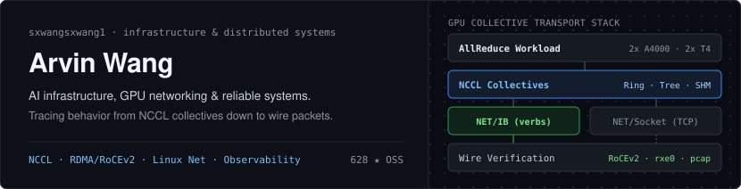

<picture>
  <source media="(prefers-color-scheme: dark)" srcset="./assets/banner-stack-dark.svg" />
  <source media="(prefers-color-scheme: light)" srcset="./assets/banner-stack-light.svg" />
  
</picture>

  
  
  

---

### GPU Networking & Benchmark Labs

<table>
  <tr>
    <td width="50%" valign="top">
      <h4><a href="https://github.com/sxwangsxwang1/softroce-rdma-nccl-lab">softroce-rdma-nccl-lab</a></h4>
      
<code>2x RTX A4000</code> · <code>Soft-RoCEv2</code> · <code>NET/IB</code> · <code>libibverbs</code>

      
Two-node cloud GPU lab tracing collective traffic from verbs queue pairs through NCCL AllReduce over software RoCEv2 (<code>rxe0</code>).

      <ul>
        <li>Confirmed RoCEv2 traffic and <code>NET/IB</code> data channels with a 200-packet capture; compared RDMA against TCP sockets with zero validation errors.</li>
        <li>Published 44 original evidence files, derived tables/plots, run scripts, and documented measurement limits.</li>
      </ul>
    </td>
    <td width="50%" valign="top">
      <h4><a href="https://github.com/sxwangsxwang1/nccl-allreduce-bench">nccl-allreduce-bench</a></h4>
      
<code>2x Tesla T4</code> · <code>NCCL</code> · <code>Ring / Tree</code> · <code>SHM Fallback</code>

      
Controlled single-variable <code>nccl-tests</code> runs examining how topology, transport, algorithm, and protocol shape the AllReduce <code>busBW</code> curve.

      <ul>
        <li>Changed one NCCL setting per run and verified actual channel/protocol selection via diagnostic logs.</li>
        <li>Analyzed Ring vs. Tree crossover points and shared-memory (<code>SHM</code>) fallback when PCIe P2P is unavailable.</li>
      </ul>
    </td>
  </tr>
</table>

---

### Open-Source Software & Upstream Patches

| Repository | Scope & Stack | Summary |
| :--- | :--- | :--- |
| **[chatpassport](https://github.com/sxwangsxwang1/chatpassport)** | `TypeScript` `WXT` `Zod` `Vitest` | Local-first browser extension and open format for carrying conversation context across ChatGPT, Claude, Gemini, and DeepSeek without a backend (620+ stars, [Chrome Web Store](https://chromewebstore.google.com/detail/chatpassport/anmmhpfpbaafkgdhalbllhmaejeappmb)). |
| **[sqlfluff/sqlfluff](https://github.com/sqlfluff/sqlfluff/pull/9150)** | `Python` · PostgreSQL | PostgreSQL 18 temporal foreign key parsing support ([PR #9150](https://github.com/sqlfluff/sqlfluff/pull/9150), merged). |
| **[dbcli/mycli](https://github.com/dbcli/mycli/pull/2446)** | `Python` · CLI / DSN | Fix DSN encoding for usernames containing `/`, with regression tests ([PR #2446](https://github.com/dbcli/mycli/pull/2446), merged). |

---

### Technical Domains

<table>
  <tr>
    <td width="33%" valign="top">
      <strong>Collective Comm &amp; RDMA</strong> 
      NCCL, CUDA, RDMA / RoCEv2, Soft-RoCE (<code>rxe</code>), <code>libibverbs</code>, AllReduce Topology &amp; Transport
    </td>
    <td width="33%" valign="top">
      <strong>Systems &amp; Networking</strong> 
      Linux Networking, Packet Capture (<code>pcap</code>), TCP/IP, Observability, Distributed Reliability
    </td>
    <td width="34%" valign="top">
      <strong>Languages &amp; Tooling</strong> 
      Python, TypeScript, Bash, SQL / PostgreSQL, Reproducible Benchmarking, Automated Testing
    </td>
  </tr>
</table>
